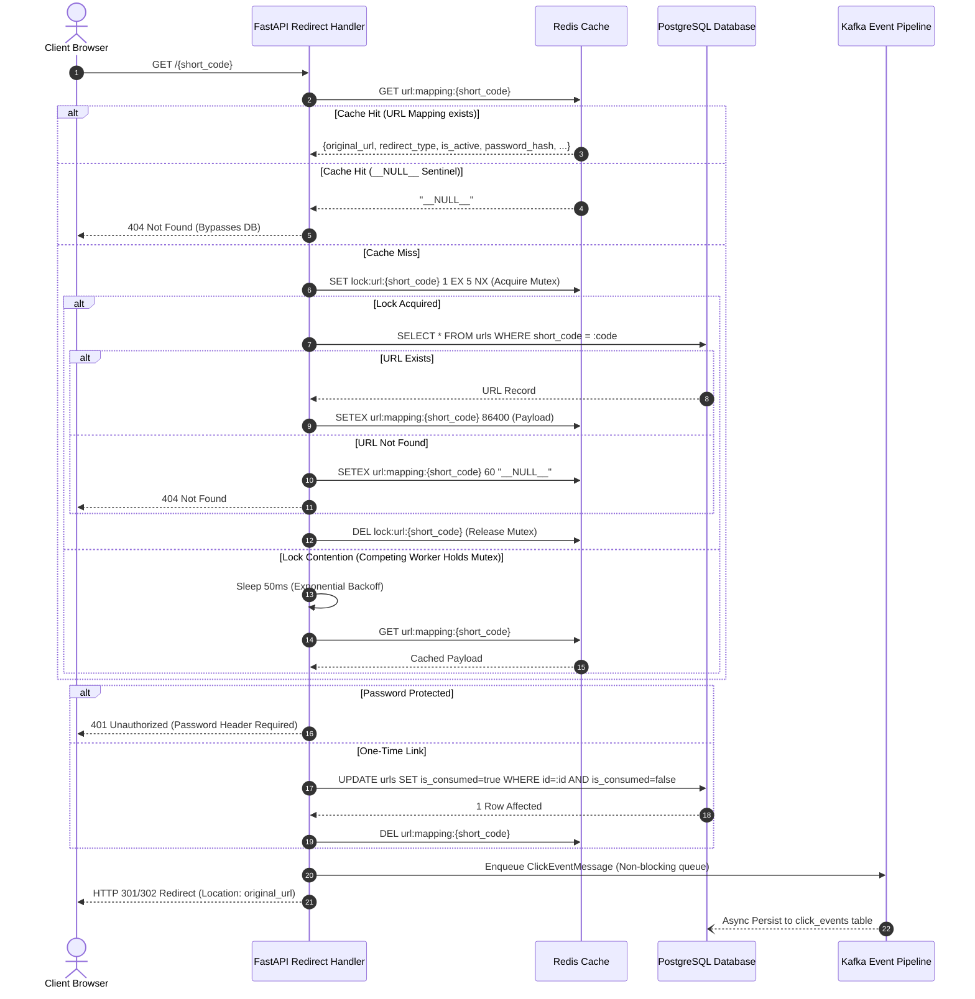

# System Architecture — URL Shortener & Distributed Analytics Platform

## High-Level System Architecture

The platform separates the **Read/Redirect Critical Path** from the **Write Ingestion & Analytics Path** to guarantee that click redirection operates at in-memory speeds without database write contention.

```mermaid
flowchart TD
    Client["Client / Web Browser / API Consumer"]
    
    subgraph Edge & Routing Layer
        Ingress["Kubernetes Ingress / Reverse Proxy (Nginx)"]
        SecMW["Security Headers & Correlation MW (X-Request-ID)"]
        RateMW["Sliding-Window Rate Limiter (Redis)"]
    end
    
    subgraph Core Application Service
        FastAPI["FastAPI Core Engine (app.main)"]
        RedirSvc["RedirectService (app.services.redirect_service)"]
        UrlSvc["UrlService (app.services.url_service)"]
        AuthSvc["AuthService (app.services.auth_service)"]
        CacheSvc["CacheService (app.cache.cache_service)"]
        Producer["Kafka EventProducer (app.events.producer)"]
    end

    subgraph Data & Caching Tier
        Redis[("Redis 7 In-Memory Store\n- Cache-Aside Mapping\n- Distributed Mutex Locks\n- Sliding-Window Rate Limits")]
        Postgres[("PostgreSQL 16 Primary DB\n- URLs & Domain Schemas\n- Users & RBAC\n- Analytics Aggregate Rollups")]
    end

    subgraph Asynchronous Event Streaming Pipeline
        Queue["In-Memory Bounded Queue\n(asyncio.Queue maxsize=5000)"]
        Kafka["Apache Kafka Broker\nTopic: url-clicks\nTopic: url-clicks-dlq"]
        Worker["Analytics Consumer Worker\n(app.workers.analytics_worker)"]
        Dedupe["LRU Deduplication Cache"]
        AggCron["Daily Aggregation Cron\n(app.workers.aggregation_cron)"]
    end

    subgraph Observability
        Prom["Prometheus Scraper (:9090)"]
        Graf["Grafana Dashboard (:3000)"]
        Otel["OpenTelemetry Tracing Engine"]
    end

    %% Flow connections
    Client -->|HTTP Request| Ingress
    Ingress --> SecMW --> RateMW --> FastAPI
    
    FastAPI -->|GET /{short_code}| RedirSvc
    FastAPI -->|POST /api/v1/urls| UrlSvc
    FastAPI -->|POST /api/v1/auth| AuthSvc

    RedirSvc -->|1. Check Cache| CacheSvc
    CacheSvc <-->|Fast Path <2ms| Redis
    CacheSvc -->|2. Cache Miss Lock & Query| Postgres
    
    RedirSvc -->|3. Non-blocking Enqueue| Queue
    Queue --> Producer --> Kafka
    
    Kafka --> Worker --> Dedupe --> Postgres
    AggCron -->|Nightly Rollup| Postgres
    
    FastAPI -.->|Metrics :8000/metrics| Prom
    Prom -.-> Graf
    FastAPI -.-> Otel
```

---

## Redirection Flow & Cache Stampede Protection

The redirection path in [RedirectService](file:///e:/url_shortner/app/services/redirect_service.py) guarantees maximum resilience against cache stampedes, penetration, and expired records:



---

## Architecture Component Boundaries

| Component | Technology | Directory | Primary Role |
| :--- | :--- | :--- | :--- |
| **Presentation / HTTP** | FastAPI / Uvicorn | [app/api/v1/](file:///e:/url_shortner/app/api/v1/) | Request routing, dependency injection, Pydantic validation, status translation. |
| **Middleware** | ASGI Standard | [app/middleware/](file:///e:/url_shortner/app/middleware/) | Correlation ID tracking, HSTS/CSP security headers, sliding-window rate limiting, metrics timing. |
| **Domain Services** | Python 3.12+ Async | [app/services/](file:///e:/url_shortner/app/services/) | Business rules, SSRF blocking, Base62 generation, password verification, token rotation. |
| **Data Repositories** | SQLAlchemy 2.0 Async | [app/repositories/](file:///e:/url_shortner/app/repositories/) | Database abstraction, pagination, atomic updates, and isolation from raw SQL. |
| **Caching Tier** | Redis 7 Async | [app/cache/](file:///e:/url_shortner/app/cache/) | Cache-aside lookup, distributed mutex locks, null-sentinel insertion, invalidation. |
| **Event Streaming** | Apache Kafka / aiokafka | [app/events/](file:///e:/url_shortner/app/events/) | Non-blocking bounded queue, schema versioning, consumer deduplication, dead-letter routing. |
| **Background Daemons** | Asyncio Tasks | [app/workers/](file:///e:/url_shortner/app/workers/) | Continuous stream consumer and nightly aggregate rollups. |
| **Infrastructure** | Docker / K8s / Helm | [infra/](file:///e:/url_shortner/infra/) | Multi-stage container builds, autoscaling, ingress, and production deployment automation. |
