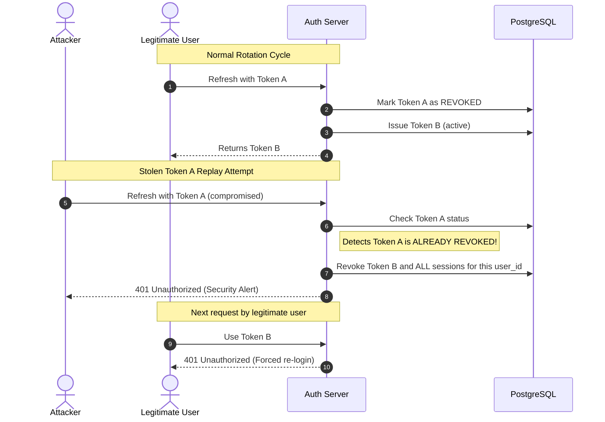

# Authentication & Authorization Architecture — URL Shortener & Distributed Analytics Platform

## 1. Dual-Authentication Paradigm

The platform supports two distinct authentication mechanisms tailored to specific operational contexts:

1. **Interactive User Authentication (OAuth2 Bearer JWT):**
   - Designed for single-page applications, web dashboards, and mobile clients.
   - Issues short-lived JWT access tokens (15 minutes) paired with rotating cryptographic refresh tokens (7 days).
2. **Machine-to-Machine API Keys (`X-API-Key`):**
   - Designed for server-to-server microservices, CI/CD pipelines, and bulk shortening jobs.
   - Long-lived, prefix-indexed, and cryptographically hashed with fine-grained RBAC scopes.

---

## 2. Password Hashing Specification (Argon2id)

Passwords are never stored in plaintext or with weak algorithms (MD5, SHA-256, standard bcrypt). Instead, passwords are processed through **Argon2id**, the winner of the Password Hashing Competition and recommended by OWASP.

Implemented in [hash_password](file:///e:/url_shortner/app/core/security.py) using `argon2-cffi`:
- **Algorithm:** Argon2id (hybrid data-dependent and data-independent memory access)
- **Time Cost ($t$):** 3 iterations
- **Memory Cost ($m$):** 65,536 KiB (64 MiB RAM per hash)
- **Parallelism ($p$):** 4 threads
- **Salt:** 16-byte cryptographically secure random salt generated per password

This configuration forces attackers attempting GPU or ASIC cracking to allocate 64 MiB of high-speed memory per hash attempt, rendering mass dictionary attacks economically unviable.

---

## 3. Refresh Token Rotation & Cryptographic Reuse Detection

To neutralize the risk of persistent session hijacking if a client refresh token is stolen, the platform enforces strict **single-use token rotation**:

1. **Hashed Token Storage:** Refresh tokens are generated as 32-byte URL-safe strings (`secrets.token_urlsafe(32)`). Only their **SHA-256 hash** is stored in `refresh_tokens.token_hash`.
2. **Atomic Single-Use Invalidation:** Presenting a valid refresh token immediately marks it as `is_revoked = true` and records `revoked_at`.
3. **Automated Session Revocation:** If a revoked token is presented again, the system recognizes an active replay attack and executes an immediate revocation cascade across **all** active tokens owned by that `user_id`.

---

## 4. Brute-Force Lockout Policy

To prevent online credential-guessing attacks:
- Each user record tracks `failed_login_attempts` and `locked_until`.
- Upon 5 consecutive failed login attempts, the account is locked for **15 minutes** (`locked_until = NOW() + 15m`).
- Any login attempts while `NOW() < locked_until` are immediately rejected with **HTTP 403 Forbidden** [AccountLockedException](file:///e:/url_shortner/app/core/exceptions.py).
- A successful login resets `failed_login_attempts = 0` and clears `locked_until`.

---

## 5. Role-Based Access Control (RBAC) & API Key Scopes

### User Roles
- `admin`: Global administrative privileges (abuse takedown, domain blocking, audit logs).
- `user`: Standard account holder (URL creation, analytics viewing, API key management).

### API Key Fine-Grained Scopes
- `urls:read`: Query URL metadata and listings.
- `urls:write`: Create, update, or soft-delete URLs.
- `analytics:read`: Query clickstream metrics and stream CSV exports.
- `admin:all`: Full administrative control for automation bots.
