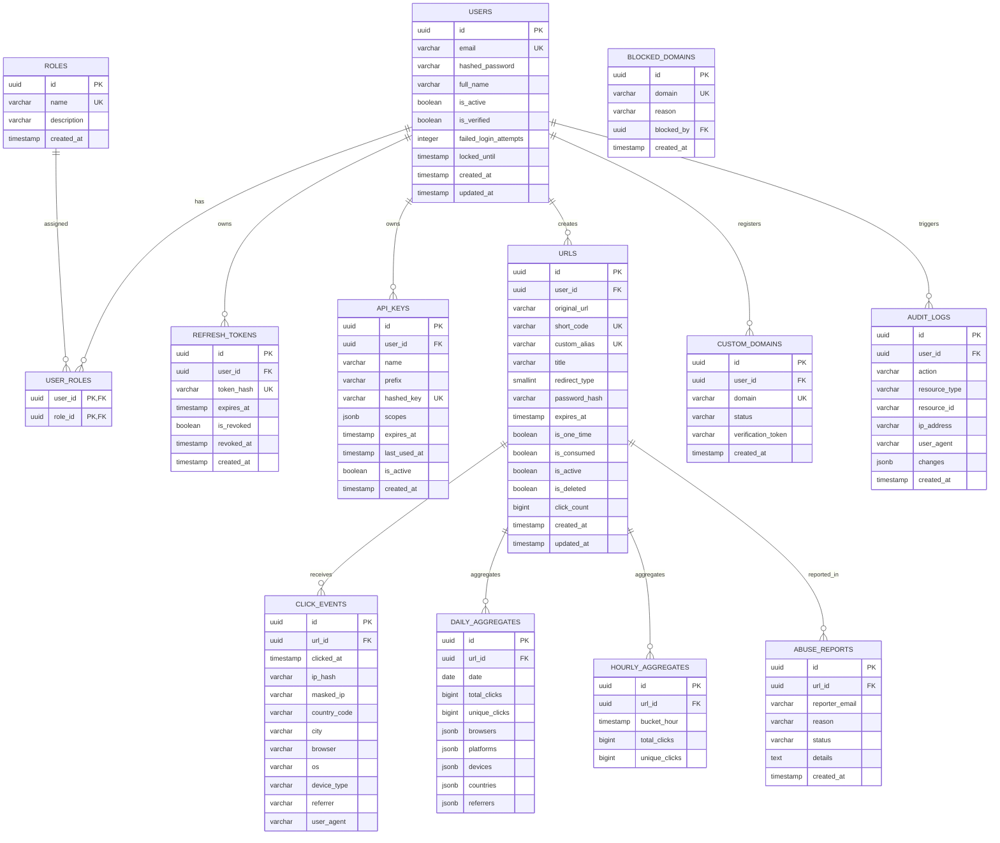

# Database Schema & Data Architecture — URL Shortener & Distributed Analytics Platform

## 1. Entity-Relationship Diagram (ERD)



---

## 2. Table Specifications & Indexing Strategy

### Table: `urls`
Primary registry of all shortened URLs and custom aliases.
- **Indexes:**
  - `ix_urls_short_code` (B-Tree, UNIQUE): Guaranteed $O(\log N)$ lookup during URL redirection.
  - `ix_urls_custom_alias` (B-Tree, UNIQUE): Resolves branded/custom aliases.
  - `ix_urls_user_id` (B-Tree): Filters URLs by owner in dashboard listings.
  - `ix_urls_is_active_expires_at`: Composite index for pruning expired links.

### Table: `click_events`
High-volume raw clickstream partition.
- **Indexes:**
  - `ix_click_events_url_id_clicked_at` (Composite B-Tree): Essential for timeseries range scans on individual URLs.
  - `ix_click_events_clicked_at`: Partition pruning key for archival and rollups.
- **Partitioning Strategy (Production PostgreSQL):**
  In high-scale deployments, `click_events` is partitioned by range on `clicked_at`:
  ```sql
  CREATE TABLE click_events (
      id UUID NOT NULL,
      url_id UUID NOT NULL,
      clicked_at TIMESTAMPTZ NOT NULL,
      ...
  ) PARTITION BY RANGE (clicked_at);

  CREATE TABLE click_events_2026_11 PARTITION OF click_events
      FOR VALUES FROM ('2026-11-01 00:00:00+00') TO ('2026-12-01 00:00:00+00');
  ```

### Table: `api_keys`
- **Prefix Lookup Indexing:** The `prefix` column (first 8 chars of key) has an index `ix_api_keys_prefix`. Key validation locates matching candidates by prefix first, avoiding full-table hash comparisons.

---

## 3. Database Migration Management

Database migrations are managed via Alembic in [alembic/versions/001_initial_schema.py](file:///e:/url_shortner/alembic/versions/001_initial_schema.py).

### Commands
```bash
# Upgrade to latest schema revision
alembic upgrade head

# Rollback one revision (verified reversible)
alembic downgrade -1

# Generate new autodetected migration
alembic revision --autogenerate -m "add_new_feature"
```
