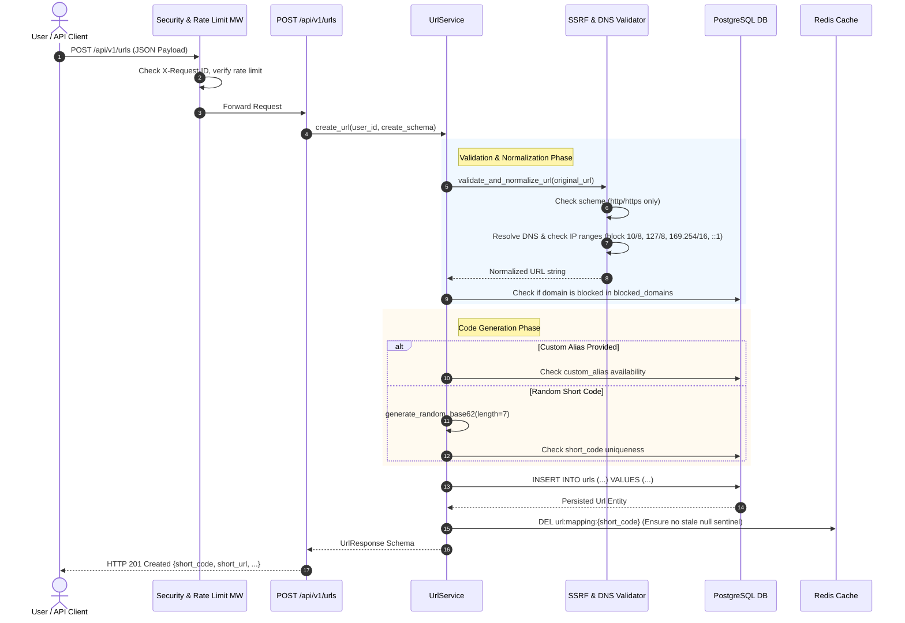
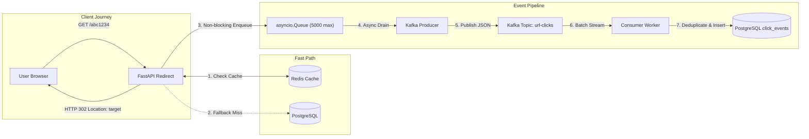

# Data Flow Architecture — URL Shortener & Distributed Analytics Platform

## 1. URL Creation & Ingestion Data Flow

The flow of data when a client submits a long URL for shortening:

---

## 2. Click Redirection & Analytics Pipeline Data Flow

---

## 3. Analytics Aggregation & Reporting Data Flow

Data flow for dashboard queries and high-volume CSV exports:

1. **User Request:** `GET /api/v1/analytics/{short_code}?period=30d`.
2. **Access Control:** [AnalyticsService](file:///e:/url_shortner/app/services/analytics_service.py) verifies the requesting user is the URL owner or an admin.
3. **Hybrid Aggregation Query:**
   - Historical days (older than today) query pre-computed rollups in `daily_aggregates` (sub-10ms response).
   - Current day queries recent records in `click_events` and merges with historical figures.
4. **CSV Streaming:** `GET /api/v1/analytics/{short_code}/export` streams data rows directly from the database cursor to the client using chunked transfer encoding, maintaining a constant memory footprint regardless of dataset size.
