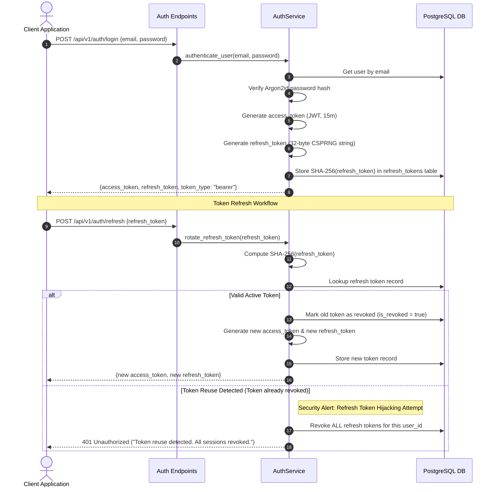

# Operational Workflows — URL Shortener & Distributed Analytics Platform

## Workflow 1: Authentication & Refresh Token Rotation with Reuse Detection



---

## Workflow 2: One-Time Self-Destructing Link Lifecycle

1. **Creation:** User creates URL with `is_one_time = true`.
2. **Storage:** Record created in `urls` with `is_one_time=true, is_consumed=false, is_active=true`.
3. **First Request:**
   - Client requests `GET /{short_code}`.
   - [RedirectService](file:///e:/url_shortner/app/services/redirect_service.py) executes atomic SQL:
     ```sql
     UPDATE urls SET is_consumed=true, is_active=false WHERE id=:id AND is_one_time=true AND is_consumed=false;
     ```
   - Transaction succeeds (`rowcount == 1`).
   - Short code mapping deleted from Redis cache.
   - Client redirected via HTTP 302 to destination URL.
4. **Second Request:**
   - Subsequent client requests `GET /{short_code}`.
   - System checks database record and observes `is_consumed == true`.
   - Endpoint raises [LinkAlreadyConsumedException](file:///e:/url_shortner/app/core/exceptions.py), returning **HTTP 410 Gone** with error details.

---

## Workflow 3: Machine-to-Machine API Key Authentication

1. **Issuance:** Authenticated developer calls `POST /api/v1/api-keys` with scopes `["urls:read", "urls:write"]`.
2. **Generation:**
   - 32 random bytes generated, formatted as `url_live_{token}`.
   - Prefix `url_live_` + first 8 characters saved in `api_keys.prefix`.
   - Plaintext key is displayed **once** in the HTTP 201 response.
   - SHA-256 digest is persisted in `api_keys.hashed_key`.
3. **Invocation:** Client sends HTTP header `X-API-Key: url_live_abc123...`.
4. **Resolution:**
   - Middleware extracts prefix, locates candidates in database.
   - Compares SHA-256 hash using `secrets.compare_digest()`.
   - Verifies expiration date and required scopes before dispatching to business logic.

---

## Workflow 4: Abuse Reporting & Domain Takedown

1. **Report Submission:** Public user submits `POST /api/v1/admin/abuse` with `url_id` and violation reason (phishing, malware, spam).
2. **Review:** Administrator reviews pending reports via `GET /api/v1/admin/abuse/pending`.
3. **Takedown Action:**
   - Admin calls `POST /api/v1/admin/domains/block` specifying domain and reason.
   - Domain is inserted into `blocked_domains` table.
   - All existing active URLs pointing to this domain are set to `is_active = false`.
   - Redis cache keys for all affected short codes are purged immediately.
